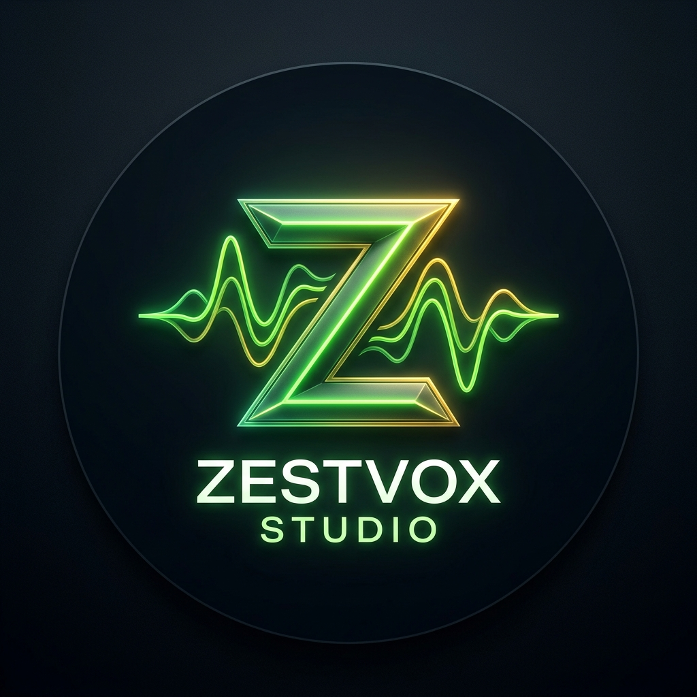
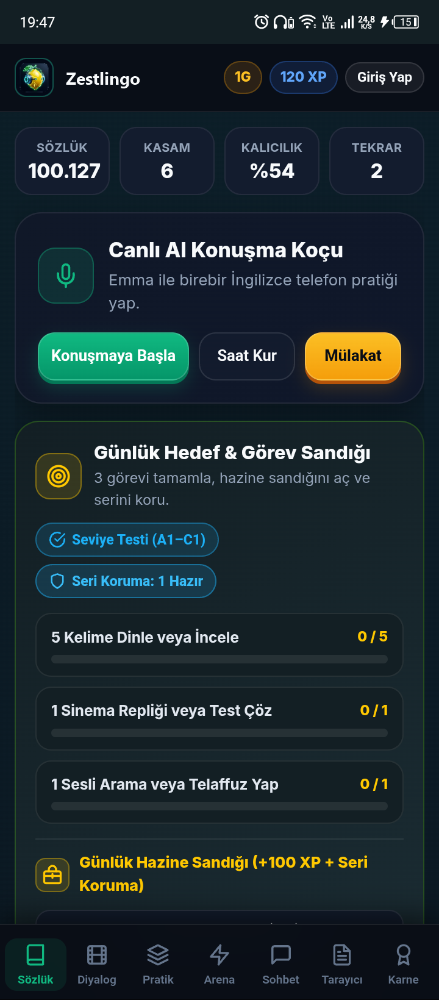
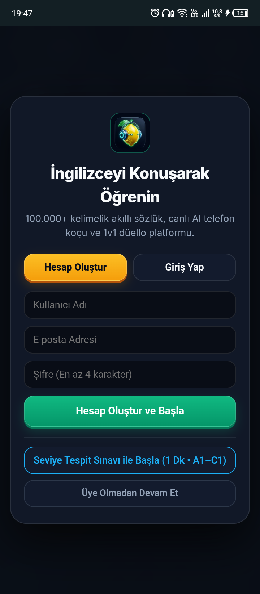

# 🍋 Zestlingo *(Limon AI)*
### Yapay Zekâ Destekli İngilizce Kelime, Aralıklı Tekrar ve Canlı Sesli Konuşma Koçu
**Geliştirici:** **Zestvox Studio** (**Samet Atabey**)

-success?style=for-the-badge)

---

## 📖 Genel Bakış

**Zestlingo** *(geliştirme aşamasındaki ilk adıyla **Limon AI**)*, bağımsız yazılım geliştiricisi **Samet Atabey** tarafından kurulan **Zestvox Studio** bünyesinde geliştirilmekte olan, **Android** ve **Web** tabanlı bir İngilizce kelime öğrenme, aralıklı tekrar (*spaced repetition*) ve canlı sesli telaffuz/konuşma pratiği uygulamasıdır.

Uygulama şu anda **v1.6.0 ön sürüm (kapalı test)** aşamasındadır.

---

## 📊 Yazılım Bilgi Kutusu

| Özellik | Detay |
| :--- | :--- |
| **Uygulama Adı** | **Zestlingo** *(İlk çalışma adı: Limon AI)* |
| **Geliştirici Stüdyo** | **Zestvox Studio** |
| **Kurucu ve Baş Geliştirici** | **Samet Atabey** *(Tarsus, Mersin)* |
| **Mevcut Sürüm** | `1.6.0` *(Kapalı Test / Ön Sürüm)* |
| **İşletim Sistemi / Platform** | Android (`API 24–36`), Web (`HTML5`) |
| **Teknoloji Altyapısı** | Java, JavaScript (ES6+), HTML5, CSS3, Firebase Realtime Database, Web Speech API & Android Native TTS/STT |
| **Kategori** | Dil Eğitimi, Eğitim Teknolojisi (EdTech), Yapay Zekâ |
| **Lisans** | Özel Mülk (*Freemium*) |

---

## 📱 Ekran Görüntüleri (v1.6.0 Test Sürümü)

  
    
  
  &nbsp;&nbsp;&nbsp;
  

---

## ⚙️ Temel Teknik Özellikler ve Modüller

1. **Akıllı Sözlük ve Aralıklı Tekrar (Spaced Repetition):**
   - **100.000+** İngilizce-Türkçe kelime ve deyim veritabanı.
   - **CEFR (A1–C1)** seviyelerine göre sınıflandırma ve sektörel mesleki paketler (*Yazılım & AI, Tıp, Havacılık, Hukuk, İş & Finans, YDS/IELTS*).
   - Öğrenilen kelimelerin unutulma eğrisine göre otomatik tekrar planlaması.

2. **Canlı AI Sesli Telefon Koçu & Doğal Dil İşleme (NLP) Akıcılığı:**
   - **Emma (UK)**, **Jake (US)** ve **Mr. Sterling (İş/Mülakat)** sesli koç profilleriyle birebir telefon görüşmesi simülasyonu.
   - **Aksan ve Duraklama Toleransı:** Kullanıcının konuşma sırasındaki doğal duraklamalarını, dolgu kelimelerini (*uh, umm, I think*) ve fonetik telaffuz farklarını tolere eden esnek değerlendirme motoru.
   - Cümle sınırlarını koruyan kesintisiz **Hibrit Ses Sentezleme (Cloud Neural TTS + Android Native TTS)**.

3. **Sinema Replikleri, Kelime Kampı ve 1v1 Kelime Arenası:**
   - Dizi ve film sahneleri üzerinden bağlamsal dinleme ve replik tamamlama.
   - 3D bilgi kartları (*Flashcards*), boşluk doldurma, eş anlamlı eşleştirme, dikte ve yazma (*Essay*) stüdyosu.
   - Gerçek zamanlı **1v1 Kelime Düellosu** ve **CEFR Seviye Tespit Sınavı**.

---

## 🚀 Zestvox Studio (Samet Atabey) Proje Ekosistemi

**Zestvox Studio**, bağımsız yazılım geliştiricisi **Samet Atabey** tarafından kurulan yazılım ve yapay zekâ girişimidir. Stüdyo çatısı altında geliştirilen başlıca projeler şunlardır:

| Proje Adı | Türü | Açıklama | Durumu |
| :--- | :--- | :--- | :--- |
| **Zestlingo** *(Limon AI)* | Mobil ve Web Uygulaması | İngilizce kelime dağarcığı, aralıklı tekrar ve yapay zekâ destekli sesli telaffuz/konuşma pratiği yazılımı | Kapalı test aşamasında (`v1.6.0`) |
| **PatiFlash** | Görüntü İşleme & Yapay Zekâ | Sokak hayvanlarının trafikte güvenliğini sağlamaya yönelik görüntü işleme ve yapay zekâ tabanlı erken uyarı projesi | Geliştirme aşamasında |
| **BikeWay** | Mobil Uygulama | Bisiklet kullanıcıları için Android ve GPS tabanlı sürüş, rota ve mikro mobilite asistanı | Geliştirme aşamasında |
| **Diğer Yazılımlar** | Oyun, Uygulama ve Otomasyon | Zestvox Studio bünyesinde ilerleyen süreçte geliştirilmesi planlanan oyun, mobil uygulama ve web otomasyon araçları | Planlama aşamasında |

---

## 🔒 Gizlilik Politikası ve Veri Güvenliği

Uygulamanın Google Play Veri Güvenliği (*Data Safety*) standartlarına uygun resmi gizlilik politikası ve hesap silme yönergeleri için:
- 📄 [Gizlilik Politikası ve Veri Güvenliği Beyanı (`privacy_policy.html`)](privacy_policy.html)

---

  © 2026 <strong>Zestvox Studio</strong> • Kurucu & Geliştirici: <strong>Samet Atabey</strong>

